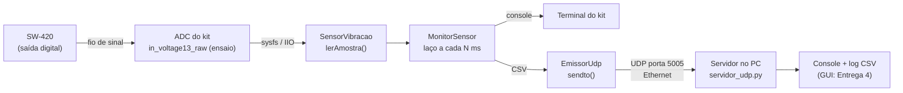
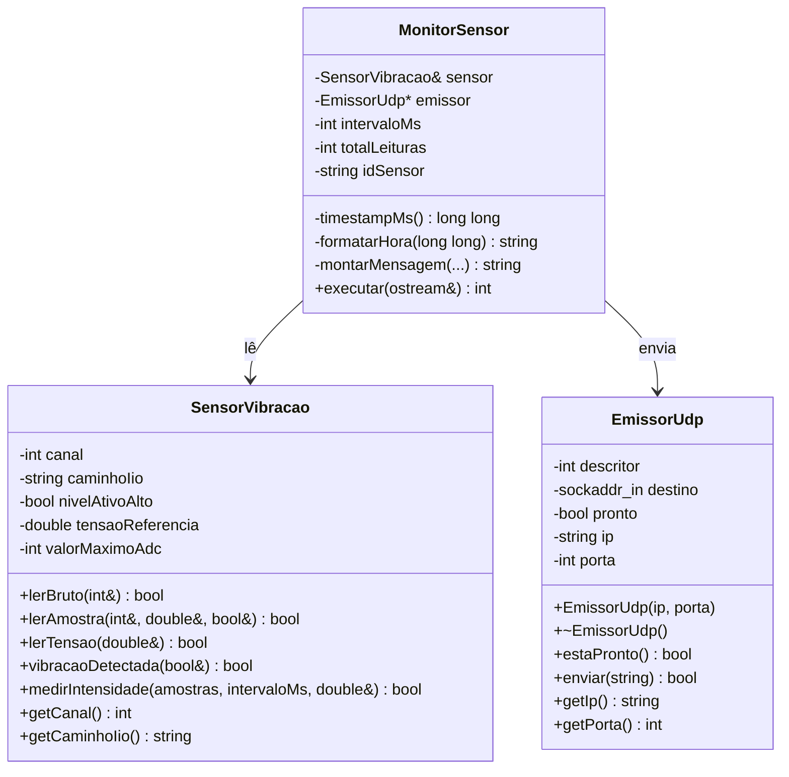
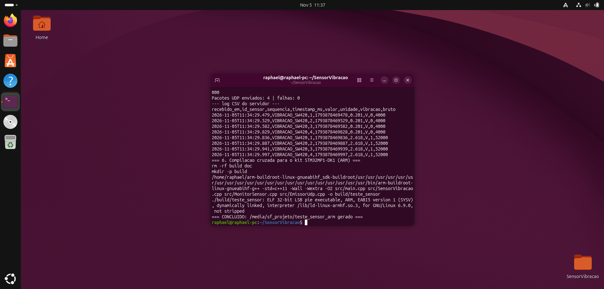

# Sensor de Vibração SW-420 — Monitoramento Inteligente de Carga

Projeto de Programação Aplicada 2026 (IME) — grupo do **Sensor de Vibração (SW-420, digital)**.
Integrantes: Ferraiollo, Brasil Barreto, Oppelt.

## Descrição geral

O sistema monitora a integridade de uma carga sensível. Este módulo é responsável
pelo sensor de vibração **SW-420**, que detecta movimentações, impactos ou
transporte indevido. Ele roda no kit **STM32MP1-DK1** (Linux embarcado), lê o sensor
continuamente e **envia cada leitura por UDP** a um servidor central na rede local.

**Estado atual: Entrega 3** — envio das leituras via UDP + documentação do protocolo.
A interface gráfica de monitoramento no servidor será a Entrega 4.



## Como o sensor é lido

O SW-420 tem saída digital (comparador LM393), mas no kit o pino de sinal é ligado a
uma **entrada do ADC**. A leitura é feita pelo subsistema IIO do Linux:

```
/sys/bus/iio/devices/iio:device0/in_voltageX_raw
```

A classe converte o valor bruto em volts (`bruto * 3,3 / 65535`) e considera
**nível alto** (vibração) quando a tensão é maior ou igual a 1,65 V.

Ligação (3,3 V, **nunca 5 V**): VCC → 3V3 · GND → GND · Sinal → pino do ADC.

**Parâmetros usados no ensaio no kit** (Buildroot, Linux 6.9.8 armv7l). O mapeamento exato do canal IIO para a identificação do conector físico não foi comprovado neste log:

| Item | Valor |
|---|---|
| Resolução do ADC | 16 bits (`0..65535`) |
| Referência | 3,3 V |
| Canal da montagem validada | **13** (`in_voltage13_raw`); correspondência com o pino físico deve ser conferida na placa |
| Repouso no ensaio de 07/11/2026 | **0,118 a 0,155 V** no canal 13; sem alertas |

## Protocolo de comunicação (UDP)

- **Transporte:** UDP, sem conexão. **Kit → servidor**, um datagrama por leitura.
- **Servidor:** IP do PC na rede do kit (ensaio real: `10.0.1.100`), **porta `5005`** (configurável).
- **Frequência:** a cada `intervalo_ms` (padrão **100 ms** = 10 pacotes/s).
- **Formato:** texto UTF-8, **CSV com 7 campos separados por vírgula**, sem quebra de linha final
  e com no máximo ~60 bytes.

```
id_sensor,sequencia,timestamp_ms,valor,unidade,vibracao,bruto
```

| # | Campo | Tipo | Descrição | Exemplo |
|---|---|---|---|---|
| 1 | `id_sensor` | texto (sem vírgula) | Identifica o sensor/grupo | `VIBRACAO_SW420` |
| 2 | `sequencia` | inteiro ≥ 1 | Contador de pacotes; permite detectar perda e reinício | `12` |
| 3 | `timestamp_ms` | inteiro | Instante da leitura: ms desde 01/01/1970 UTC | `1762345678123` |
| 4 | `valor` | decimal (3 casas) | Tensão no pino do sensor | `2.618` |
| 5 | `unidade` | texto | Unidade do `valor` (sempre `V`) | `V` |
| 6 | `vibracao` | `0` ou `1` | `1` = vibração detectada (nível alto), `0` = repouso | `1` |
| 7 | `bruto` | inteiro 0..65535 | Valor bruto do ADC (16 bits) | `52000` |

**Exemplos de mensagens**

```text
VIBRACAO_SW420,1,1793878057829,0.201,V,0,4000      <- repouso
VIBRACAO_SW420,2,1793878058038,2.618,V,1,52000     <- vibração
```

**Regras do receptor**
- Mensagem com número de campos diferente de 7, ou campo numérico inválido, deve ser descartada
  (o `servidor_udp.py` conta como "inválido").
- `sequencia` maior que a anterior + 1 → houve **perda** de pacotes (UDP não garante entrega);
  `sequencia` voltando a `1` → o emissor foi **reiniciado**; menor que a anterior → **fora de ordem**.
- Os campos `valor`, `unidade` e `timestamp_ms` permitem integrar vários sensores no servidor final,
  pois cada grupo envia o mesmo padrão com seu próprio `id_sensor`.

## Estrutura do código

| Arquivo | Conteúdo |
|---|---|
| `src/SensorVibracao.h/.cpp` | Leitura e interpretação do sensor (ADC → volts → estado) |
| `src/EmissorUdp.h/.cpp` | Socket UDP: cria o socket, envia datagramas, fecha no destrutor |
| `src/MonitorSensor.h/.cpp` | Laço de leitura; monta a mensagem do protocolo e a envia pelo `EmissorUdp` |
| `src/main.cpp` | Apenas instancia as classes e as executa |
| `servidor_udp.py` | Servidor de teste no PC: recebe, valida, detecta perdas e grava log CSV |
| `Doxyfile` / `Makefile` | Documentação e compilação (nativa e cruzada) |
| `compilar_arm.sh` | Compila (nativo + ARM) e testa o UDP na VM Ubuntu |
| `teste_no_kit.sh` | Roda no kit: teste em repouso e vibrando, enviando ao servidor |



Todos os métodos de leitura/envio retornam `bool` e só alteram os parâmetros de saída em caso
de sucesso. O código não usa variáveis globais nem funções fora de classes (exceto `main`).

## Dependências

- Compilador C++11 (`g++`) e `make`.
- Doxygen (opcional, para gerar a documentação).
- Python 3 (apenas para o `servidor_udp.py` no PC; só biblioteca padrão).
- Para o kit: toolchain `arm-buildroot-linux-gnueabihf` fornecida pelo professor
  (`arm-buildroot-linux-gnueabihf_sdk-DK2.tar.gz`).

## Compilação e execução

### 1) Compilar para o kit (na VM Ubuntu)

```bash
cd SensorVibracao
make clean
make CXX=$HOME/arm-buildroot-linux-gnueabihf_sdk-buildroot/bin/arm-buildroot-linux-gnueabihf-g++
file build/teste_sensor        # deve indicar: ELF 32-bit LSB ... ARM, EABI5
```

Atalho: `bash compilar_arm.sh` (compila nativo, testa o UDP em loopback e compila para ARM).

### 2) Rede utilizada no ensaio físico (07/11/2026)

A placa STM32MP1-DK1 foi ligada à porta LAN de um roteador por **Ethernet (eth0)**;
o computador servidor Windows utilizou **Wi-Fi da mesma rede local**. Não foi necessário
que o computador tivesse uma porta Ethernet.

| Equipamento | Endereço no ensaio |
|---|---|
| Kit STM32MP1 (origem dos pacotes) | `10.0.1.101` |
| PC Windows (servidor) | `10.0.1.100` |
| Transporte | UDP, porta `5005` |
| Canal IIO testado | `13` (`in_voltage13_raw`) |

Esses são **IPs do ensaio**, não endereços fixos universais. Em outra rede, descubra
os endereços atuais com `ip addr show eth0` no kit e `ipconfig` no computador.

No ensaio registrado, o `ping` executado pelo kit teve 2/2 respostas ausentes, **mas**
o servidor recebeu comprovadamente os 80 datagramas UDP. Falha de ICMP, isoladamente,
não invalida a comunicação UDP; a causa do bloqueio do ping não foi identificada.
O Windows deve permitir o recebimento UDP na porta 5005 (regra de firewall, se necessário).

### 3) Iniciar o servidor no PC

No PowerShell, na pasta que contém `servidor_udp.py`:

```powershell
python -u servidor_udp.py --porta 5005 --log log_sensor.csv --max 80
```

O servidor recebe, valida e registra as mensagens. Para execução contínua, omita `--max 80`
e interrompa com `Ctrl+C`.

### 4) Transferir e executar no kit

Após descobrir os IPs reais na mesma rede, por exemplo os utilizados no ensaio:

```powershell
scp -O .\teste_sensor_arm root@10.0.1.101:/home/root/teste_sensor
scp -O .\teste_no_kit.sh root@10.0.1.101:/home/root/teste_no_kit.sh
```

No Tera Term (porta serial Micro-USB) ou terminal SSH do kit:

```sh
mkdir -p /home/root
cd /home/root
chmod +x teste_sensor
sh teste_no_kit.sh 10.0.1.100 13 5005
```

O teste de bancada realiza 30 leituras em repouso e, após contagem regressiva,
50 leituras com movimentação do módulo. A cada 100 ms é enviado um datagrama.
O script salva sua saída em `/home/root/resultado_teste_kit.txt`.

Para o monitoramento contínuo, sem limitar as leituras:

```sh
./teste_sensor 13 100 0 10.0.1.100 5005
```

Os exemplos usam **13 explicitamente** porque foi o canal validado. O executável de
referência mantém `6` como valor padrão quando o argumento é omitido; não confunda
esse padrão com o canal da montagem efetivamente ensaiada.

```text
./teste_sensor [canal] [intervalo_ms] [leituras] [ip_servidor] [porta] [id_sensor] [caminho_iio]
```

| Argumento | Significado | Padrão no executável |
|---|---|---|
| `canal` | X de `in_voltageX_raw` | `6` (ensaio: `13`) |
| `intervalo_ms` | pausa entre leituras | `100` |
| `leituras` | quantidade; `0` = contínuo até `Ctrl+C` | `0` |
| `ip_servidor` | IPv4 do servidor; omitido = UDP desativado | — |
| `porta` | porta UDP do servidor | `5005` |
| `id_sensor` | identificador no protocolo | `VIBRACAO_SW420` |
| `caminho_iio` | diretório IIO | `/sys/bus/iio/devices/iio:device0` |

**Teste sem o kit** (PC com IIO simulado, enviando para si mesmo):

```bash
mkdir -p /tmp/iio_sim && echo 52000 > /tmp/iio_sim/in_voltage6_raw
python3 servidor_udp.py --max 8 &
make && ./build/teste_sensor 6 50 4 127.0.0.1 5005 VIBRACAO_SW420 /tmp/iio_sim
```

**Documentação do código:** `make doc` (gera `doc/html/index.html`).

## Validação e evidências

### Resultado da comunicação física kit → PC em 07/11/2026

| Critério | Resultado observado |
|---|---:|
| Ambiente embarcado | Linux 6.9.8 `armv7l` |
| Canal IIO | 13 |
| Amostras em repouso | **30** |
| Alertas em repouso | **0** |
| Amostras com movimentação | **50** |
| Alertas com movimentação | **15 (30%)** |
| Datagramas UDP transmitidos sem falha reportada no kit | **80** |
| Datagramas UDP recebidos válidos no servidor | **80** |
| Datagramas inválidos / perdidos / fora de ordem | **0 / 0 / 0** |
| Identificador do protocolo | `VIBRACAO_SW420` |
| Servidor | `10.0.1.100:5005` |
| Origem observada pelo servidor | `10.0.1.101` |

**Verificação cruzada:** as 80 linhas do `resultado_teste_kit.txt` foram comparadas,
na mesma ordem, com as 80 linhas de `log_sensor.csv`. Sequência, valor ADC bruto,
tensão (3 casas decimais) e indicador de vibração correspondem nas 80 amostras,
sem divergências. O verificador `verificar_udp_entrega3.py` também aprovou a
consistência do CSV.

A numeração reinicia em `1` após o teste de 30 amostras, porque o script inicia
uma nova execução do emissor para as 50 amostras seguintes. O servidor identificou
o reinício e não o classificou como perda de pacote.

**Limites das evidências:** o kit estava com o relógio no ano **2000**, sem
sincronização. O timestamp emitido não é evidência da hora civil correta;
`recebido_em` é registrado no computador receptor. A porcentagem de detecção
é a fração de amostras de nível alto, não a sensibilidade metrológica do módulo
nem uma taxa de acerto por evento físico independente.

Arquivos verificáveis do ensaio físico:

- [`resultado_teste_kit.txt`](resultado_teste_kit.txt): leitura e envio de 80 amostras na placa.
- [`log_sensor.csv`](log_sensor.csv): registros efetivamente recebidos pelo PC.
- [`log_servidor_console.txt`](log_servidor_console.txt): saída do servidor, incluindo os totais finais (texto convertido de UTF-16 para UTF-8, sem alterações de conteúdo).
- [`verificar_udp_entrega3.py`](verificar_udp_entrega3.py): verificador independente do CSV (executar com `python verificar_udp_entrega3.py`).
- [`RELATORIO_VALIDACAO_ENTREGA3.md`](RELATORIO_VALIDACAO_ENTREGA3.md): conferência entre kit, CSV, servidor e código.

### Testes de desenvolvimento

1. **UDP em loopback no Windows, IIO simulado:** houve testes de repouso,
   vibração, sequência perdida simulada, reinício e mensagem inválida.
   Evidência: [`resultado_teste_udp_pc.txt`](resultado_teste_udp_pc.txt).
2. **VM Ubuntu e compilação cruzada ARM:** teste UDP local com 8 pacotes válidos
   e compilação ARM usando toolchain do professor; evidências em
   [`resultado_compilacao_arm.txt`](resultado_compilacao_arm.txt) e na imagem abaixo.



### Documentação e etapas posteriores

- `make doc` gera a documentação Doxygen (`doc/html/index.html`).
- A **interface gráfica** e a integração de todos os sensores pertencem às etapas posteriores, não à Entrega 3.
- A **fotografia da ligação física do sensor com o kit desligado**, exigida nas instruções gerais do projeto, deve ser anexada separadamente caso ainda não tenha sido entregue.
- O teste físico mostrou detecção funcional, mas não constitui certificação de confiabilidade para todos os ambientes de uso.
