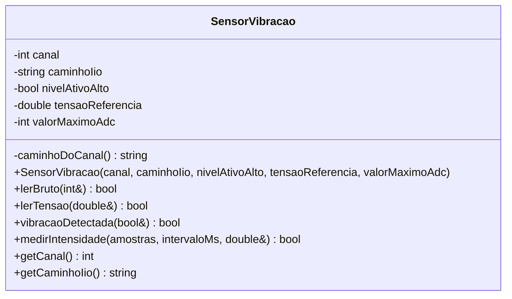
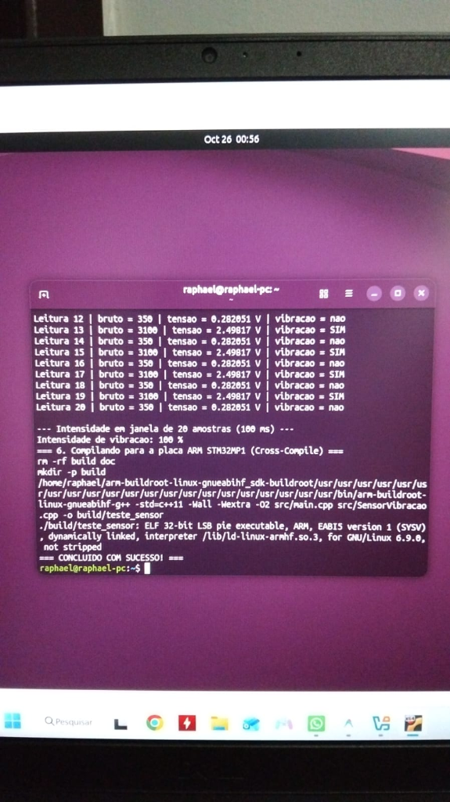

# Sensor de Vibração SW-420 — Monitoramento Inteligente de Carga

Projeto de Programação Aplicada 2026 (IME) — grupo do **Sensor de Vibração (SW-420, digital)**.

## Descrição geral

O sistema monitora a integridade de uma carga sensível. Este módulo é responsável
pelo sensor de vibração **SW-420**, que detecta movimentações, impactos ou
transporte indevido. Ele roda no kit **STM32MP1-DK1** (Linux embarcado) e, nas
próximas etapas, enviará os dados por UDP a um servidor central com interface gráfica.

**Estado atual: Entrega 1** — classe C++ de leitura do sensor, documentada com Doxygen.

## Como o sensor é lido

O SW-420 tem saída digital (comparador LM393), mas no kit o pino de sinal é ligado a
uma **entrada do ADC**. A leitura é feita pelo subsistema IIO do Linux:

```
/sys/bus/iio/devices/iio:device0/in_voltageX_raw
```

A classe converte o valor bruto em volts (`bruto * tensaoReferencia / valorMaximoAdc`)
e considera **nível alto** quando a tensão é maior ou igual à metade da referência.

Ligação (3,3 V, **nunca 5 V**): VCC → 3V3 · GND → GND · Sinal → pino do ADC.

## Estrutura do código

| Arquivo | Conteúdo |
|---|---|
| `src/SensorVibracao.h` | Declaração e documentação Doxygen da classe |
| `src/SensorVibracao.cpp` | Implementação da classe |
| `src/main.cpp` | Programa de teste (apenas instancia e testa a classe) |
| `Doxyfile` | Configuração da documentação |
| `Makefile` | Compilação nativa e cruzada |



### Métodos

- `lerBruto(int&)` — lê o valor bruto do ADC.
- `lerTensao(double&)` — valor bruto convertido para volts.
- `vibracaoDetectada(bool&)` — há vibração neste instante?
- `medirIntensidade(amostras, intervaloMs, double&)` — percentual (0–100) de amostras
  com vibração em uma janela. Existe porque a vibração gera pulsos curtos e uma única
  leitura pode perdê-los.

Todos os métodos de leitura retornam `bool` (`false` se o arquivo não abrir ou não
contiver um número) e só alteram o parâmetro de saída em caso de sucesso.

## Dependências

- Compilador C++11 (`g++`) e `make`.
- Doxygen (opcional, para gerar a documentação).
- Para o kit: toolchain `arm-buildroot-linux-gnueabihf` fornecida pelo professor.

## Compilação e execução

**No PC (Linux):**

```bash
make
./build/teste_sensor <canal> [caminho_iio]
```

**Compilação cruzada para o kit** (após carregar o ambiente da toolchain extraída
do `arm-buildroot-linux-gnueabihf_sdk-DK2.tar.gz`):

```bash
make CXX=arm-buildroot-linux-gnueabihf-g++
scp build/teste_sensor root@192.168.42.2:/home/root
# no kit:
./teste_sensor <canal>
```

`<canal>` é o número X de `in_voltageX_raw` (no kit STM32MP1-DK1, os canais expostos em `iio:device0` são **6** para o pino A4 e **13** para o pino A5, com ADC de 16 bits `0..65535`). Sem argumentos, usa o canal 6.

**Documentação:**

```bash
make doc        # gera doc/html/index.html
```

## Itens validados na bancada (Kit STM32MP1-DK1)

- [x] Descobrir os canais ADC reais no kit (`iio:device0/in_voltage6_raw` no pino A4 e `iio:device0/in_voltage13_raw` no pino A5).
- [x] Confirmar a **polaridade** do módulo (repouso em nível baixo $\approx 0{,}13\text{ V}$, ativo em nível alto $\ge 1{,}65\text{ V}$ ao vibrar).
- [x] Confirmar a **resolução e a referência do ADC** no STM32MP1-DK1 (`3,3 V` e `65535`, resolução de 16 bits).
- [x] Validar a compilação cruzada com `arm-buildroot-linux-gnueabihf-g++` na máquina virtual Ubuntu.
- [x] Transferir e executar o binário ARM nativamente na placa física **STM32MP1-DK1** (`Linux STM32MP1 6.9.8 armv7l`).
- [ ] Ajustar o potenciômetro de sensibilidade do módulo conforme necessidade do teste de impacto.
- [ ] Etapas seguintes: envio UDP e protocolo, interface gráfica, fluxograma,
      capturas de tela e análise dos valores medidos.

## Testes realizados e Evidências

1. **Compilação e teste funcional (Linux x86_64 na VM Ubuntu e Windows):**
   Compilação com `-std=c++11 -Wall -Wextra -Wpedantic -Werror` e execução das 20 leituras instantâneas alternando entre vibração (`3100` $\rightarrow 2{,}498\text{ V} \rightarrow$ `SIM`) e repouso (`350` $\rightarrow 0{,}282\text{ V} \rightarrow$ `nao`), além do cálculo de intensidade na janela de 20 amostras (`100 %`).

2. **Compilação cruzada ARM para o kit STM32MP1-DK1 (`arm-buildroot-linux-gnueabihf-g++`):**
   ```text
   /home/raphael/arm-buildroot-linux-gnueabihf_sdk-buildroot/.../bin/arm-buildroot-linux-gnueabihf-g++ -std=c++11 -Wall -Wextra -O2 src/main.cpp src/SensorVibracao.cpp -o build/teste_sensor
   ./build/teste_sensor: ELF 32-bit LSB pie executable, ARM, EABI5 version 1 (SYSV), dynamically linked, interpreter /lib/ld-linux-armhf.so.3, for GNU/Linux 6.9.0, not stripped
   ```


