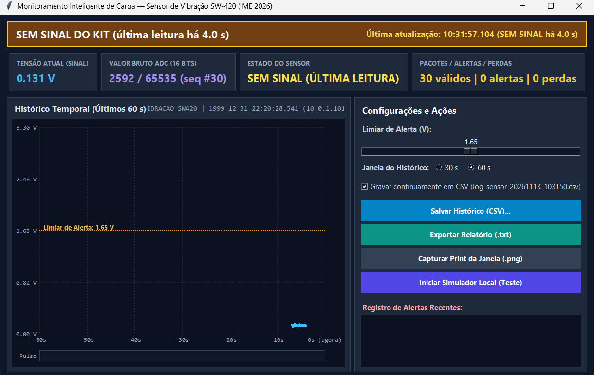
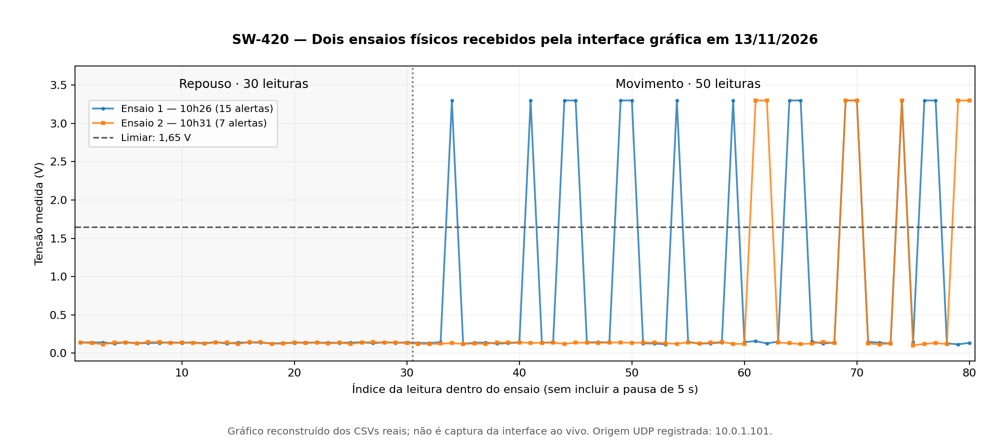

# Sensor de Vibração SW-420 — Monitoramento Inteligente de Carga

Projeto de Programação Aplicada 2026 (IME) — grupo do **Sensor de Vibração (SW-420, digital)**.
Integrantes: **Ferraiollo**, **Brasil Barreto**, **Oppelt**.

## Descrição geral

O sistema monitora em tempo real a integridade de uma carga sensível durante o transporte.
Este módulo é responsável pelo sensor de vibração **SW-420**, que detecta movimentações,
impactos ou tentativas de violação. O software embarcado roda em espaço de usuário Linux no kit
**STM32MP1-DK1**, lê continuamente o sensor via subsistema IIO/ADC e transmite cada leitura via
**socket UDP** para o servidor central no PC, onde uma **Interface Gráfica de Monitoramento**
exibe o valor instantâneo, o gráfico temporal deslizante (30–60 s), alertas visuais de violação
e grava logs CSV e relatórios estatísticos.

**Entrega 4 validada em bancada em 13/11/2026** — Interface Gráfica de Monitoramento no PC (`interface_grafica.py`),
integrada ao transmissor embarcado C++ (`SensorVibracao`, `MonitorSensor`, `EmissorUdp`).
Foram registrados **dois ensaios reais de 80 pacotes UDP** recebidos pelo PC, sem perdas ou pacotes inválidos nos arquivos dessas sessões.

```mermaid
flowchart LR
    A["SW-420<br/>(comparador LM393)"] -->|"pino DO -> ADC"| B["ADC 16 bits<br/>in_voltage13_raw (ensaio)"]
    B -->|"sysfs IIO"| C["SensorVibracao<br/>lerAmostra()"]
    C --> D["MonitorSensor<br/>laço em tempo real"]
    D -->|"CSV (7 campos)"| E["EmissorUdp<br/>sendto()"]
    E -->|"UDP :5005<br/>Rede Local"| F["ReceptorUdpAssincrono<br/>(Thread Python)"]
    F --> G["GerenciadorHistorico<br/>CSV + Estatísticas"]
    G --> H["InterfaceMonitoramento<br/>(Tkinter GUI: Gráfico 30-60s + Alertas)"]
```



---

## Como o sensor é lido e analisado

O módulo SW-420 possui saída digital baseada no comparador LM393, ligada a uma entrada ADC do kit
STM32MP1-DK1. No ensaio físico da Entrega 3, o sinal do SW-420 foi lido em `/sys/bus/iio/devices/iio:device0/in_voltage13_raw`. O mapeamento físico deve ser conferido no kit antes de reproduzir a ligação.
A classe `SensorVibracao` converte a leitura bruta de 16 bits (`0..65535`) em tensão:

$$\text{Tensão (V)} = \frac{\text{bruto} \times 3{,}3}{65535}$$

| Parâmetro / Estado | Valor Medido / Configurado | Interpretação Física |
|---|---|---|
| Resolução e Referência do ADC | 16 bits (`0..65535`), $V_{\text{ref}} = 3{,}3\text{ V}$ | $\approx 50{,}35\ \mu\text{V}$ por nível LSB |
| Canal ADC principal | Canal **13** (`in_voltage13_raw`) utilizado na validação física anterior | O canal depende da ligação e da configuração IIO da placa |
| Estado de Repouso (carga íntegra) | $\text{bruto} \approx 2450\text{ a }3150$ ($\approx 0{,}12\text{ V a }0{,}16\text{ V}$) | Saída do comparador LM393 saturada em nível baixo ($V_{OL}$) |
| Estado de Vibração (alerta) | $\text{bruto} \ge 32768$ ($\ge 1{,}65\text{ V}$; no ensaio houve amostras a $3{,}300\text{ V}$) | Pulso de nível alto indicando impacto ou movimentação |

---

## Protocolo de comunicação (UDP)

Cada leitura gera um datagrama UDP em texto UTF-8 no formato **CSV de 7 campos** (porta padrão `5005`):

```text
id_sensor,sequencia,timestamp_ms,valor,unidade,vibracao,bruto
```

**Exemplos de pacotes do protocolo (dados de demonstração):**
```text
VIBRACAO_SW420,1,1794351651959,0.134,V,0,2660      <- sensor em repouso (normal)
VIBRACAO_SW420,2,1794351652662,2.729,V,1,54200     <- vibracao detectada (alerta)
```

---

## Estrutura do código e Diagrama de Classes

| Arquivo | Conteúdo |
|---|---|
| `src/SensorVibracao.h/.cpp` | Classe C++ de leitura e conversão do ADC IIO (`lerBruto`, `lerAmostra`, `lerTensao`, `vibracaoDetectada`, `medirIntensidade`) |
| `src/EmissorUdp.h/.cpp` | Classe C++ que encapsula o socket UDP (RAII) compatível com Linux e Windows |
| `src/MonitorSensor.h/.cpp` | Classe C++ que executa o laço periódico, formata o pacote CSV e transmite via `EmissorUdp` |
| `src/main.cpp` | Programa principal embarcado (apenas instancia as classes e executa) |
| `interface_grafica.py` | **Interface Gráfica (Entrega 4)** em Python/Tkinter 100% Orientada a Objetos |
| `servidor_udp.py` | Servidor UDP em modo texto (console) para diagnóstico rápido |
| `teste_sensor_arm` | Executável ARM (`ELF 32-bit LSB pie executable, ARM, EABI5`) compilado para o kit |
| `teste_no_kit.sh` | Script de bancada para rodar no kit (30 leituras em repouso + 50 sob vibração) |
| `INSTRUCOES_TESTE_KIT.md` | Guia passo a passo para execução na bancada com o kit físico |

### Diagrama de Classes — Embarcado (C++) e Servidor Gráfico (Python)

```mermaid
classDiagram
    class SensorVibracao {
        -int canal
        -string caminhoIio
        -bool nivelAtivoAlto
        -double tensaoReferencia
        -int valorMaximoAdc
        +lerBruto(int&) bool
        +lerAmostra(int&, double&, bool&) bool
        +lerTensao(double&) bool
        +vibracaoDetectada(bool&) bool
        +medirIntensidade(amostras, intervaloMs, double&) bool
    }
    class EmissorUdp {
        -int descritor
        -sockaddr_in destino
        -bool pronto
        -string ip
        -int porta
        +estaPronto() bool
        +enviar(string) bool
    }
    class MonitorSensor {
        -SensorVibracao& sensor
        -EmissorUdp* emissor
        -int intervaloMs
        -int totalLeituras
        -string idSensor
        +executar(ostream&) int
    }
    class AmostraSensor {
        +string id_sensor
        +int sequencia
        +int timestamp_ms
        +float valor
        +string unidade
        +int vibracao
        +int bruto
        +string ip_origem
        +de_csv(texto, ip)$ AmostraSensor
        +linha_csv() list
    }
    class GerenciadorHistorico {
        +deque amostras
        +deque eventos_alerta
        +int total_validos
        +int total_com_alerta
        +int total_perdidos
        +registrar_amostra(amostra, limiar) bool
        +exportar_csv(destino)
        +salvar_relatorio(limiar, destino) string
    }
    class ReceptorUdpAssincrono {
        -int porta
        -Queue fila
        +iniciar()
        +parar()
    }
    class InterfaceMonitoramento {
        -float limiar_alerta
        -int janela_segundos
        +alternar_simulacao()
        +salvar_csv_manual()
        +exportar_relatorio_manual()
        +capturar_print_manual()
        +executar() int
    }
    MonitorSensor --> SensorVibracao : lê
    MonitorSensor --> EmissorUdp : transmite UDP
    EmissorUdp ..> ReceptorUdpAssincrono : datagrama CSV :5005
    InterfaceMonitoramento --> ReceptorUdpAssincrono : consome fila
    InterfaceMonitoramento --> GerenciadorHistorico : registra
    GerenciadorHistorico --> AmostraSensor : armazena
```

---

## Funcionalidades da Interface Gráfica (`interface_grafica.py`)

### Requisitos Obrigatórios Atendidos
1. **Valor atual do sensor em tempo real:** cartões superiores exibindo Tensão (`V`), Valor Bruto do ADC (`0..65535`) com número de sequência, Estado (`REPOUSO (NORMAL)` ou `VIBRANDO <<< ALERTA`) e contadores de pacotes válidos, alertas e perdas.
2. **Histórico gráfico temporal (últimos 30–60 segundos):** gráfico deslizante desenhado em `tkinter.Canvas` mostrando a curva de tensão de `0,00 V` a `3,30 V`, a linha tracejada do limiar de alerta, pontos vermelhos nas amostras anômalas e uma faixa inferior de pulsos digitais.
3. **Alerta visual imediato para valores fora dos limites:** o banner superior muda instantaneamente de **Verde (`CARGA ÍNTEGRA — SENSOR EM REPOUSO`)** para **Vermelho (`ALERTA DE VIOLAÇÃO: VIBRAÇÃO DETECTADA!`)** quando a tensão atinge ou supera o limiar configurado, adicionando o evento com horário exato à lista de alertas.
4. **Salvamento dos dados em arquivo de log CSV:** gravação contínua automática em `log_sensor.csv` (com caixa de seleção para ativar/pausar) + botão **"Salvar Histórico (CSV)..."** para exportar a qualquer momento.

### Requisitos Recomendados (Bônus) Implementados
- **Configuração dinâmica de limites de alerta:** controle deslizante (*Scale*) que ajusta em tempo real o limiar de tensão (`0,20 V` a `3,10 V`, padrão `1,65 V`), reposicionando imediatamente a linha de limiar no gráfico, além de seletor de janela temporal (`30 s` ou `60 s`).
- **Exportação automática e manual de relatórios:** botão **"Exportar Relatório (.txt)"** e salvamento automático ao fechar a janela em `relatorio_monitoramento.txt`, com estatísticas completas (mínimo, média, máximo, % de vibração, perdas UDP e lista de incidentes).
- **Registro de timestamp:** exibe e registra tanto o `timestamp_ms` gerado pelo kit STM32MP1-DK1 quanto o horário exato de recepção no servidor.
- **Indicador temporal da última atualização recebida:** exibe no topo `"Última atualização: HH:MM:SS.mmm (há X.X s)"` e muda para aviso amarelo (`SEM SINAL há X.X s`) caso o kit fique mais de 3 segundos sem transmitir.

---

## Instruções de Compilação e Execução

### 1. Executar a Interface Gráfica no PC
Não há dependências externas (usa apenas bibliotecas nativas do Python 3 + `tkinter`):

```bash
# Modo normal (aguardando pacotes UDP do kit na porta 5005):
python interface_grafica.py

# Modo demonstracao (com simulador local integrado enviando pacotes UDP):
python interface_grafica.py --demo
```

### 2. Compilar e Executar no Kit STM32MP1-DK1
Na VM Ubuntu (caso deseje recompilar o binário ARM):
```bash
make clean
make CXX=$HOME/arm-buildroot-linux-gnueabihf_sdk-buildroot/bin/arm-buildroot-linux-gnueabihf-g++
```
Para enviar o binário ARM, utilize o **IP real** do kit e o **IP real** do computador na mesma rede. O ensaio físico da Entrega 3 usou kit `10.0.1.101` e PC `10.0.1.100`; confirme-os novamente antes de executar:
```bash
scp teste_sensor_arm root@IP_DO_KIT:/home/root/teste_sensor
scp teste_no_kit.sh root@IP_DO_KIT:/home/root/
ssh root@IP_DO_KIT
# No terminal do kit:
chmod +x /home/root/teste_sensor
/home/root/teste_sensor 13 100 0 IP_DO_PC 5005
```

---

## Validação física da interface gráfica — 13/11/2026

A Entrega 4 foi executada **sem `--demo`**, com a GUI recebendo mensagens UDP no computador a partir do IP do STM32 `10.0.1.101`. Foram preservados dois CSVs e dois relatórios independentes gerados pela interface durante as sessões reais. O limiar utilizado foi **1,65 V**, com 30 leituras em repouso, pausa programada de aproximadamente 5 segundos e 50 leituras com movimentação em cada ensaio.

| Métrica | Ensaio 1 (10h26) | Ensaio 2 (10h31) |
|---|---:|---:|
| Origem observada | `10.0.1.101` | `10.0.1.101` |
| Leituras registradas pelo PC | **80/80** | **80/80** |
| Alertas em repouso (30 leituras) | **0/30** | **0/30** |
| Alertas durante movimentação (50 leituras) | **15/50 (30%)** | **7/50 (14%)** |
| Pacotes perdidos / inválidos / fora de ordem | **0 / 0 / 0** | **0 / 0 / 0** |
| Tensão mínima / média / máxima | **0,115 / 0,729 / 3,300 V** | **0,102 / 0,409 / 3,300 V** |
| Pausa observada entre as fases | **5,10 s** | **5,05 s** |

Os dados foram conferidos com `verificar_gui_entrega4.py`, incluindo identificação, IP de origem, sequência `1..30` e `1..50`, correspondência bruto–tensão e coerência de alerta. O teste automatizado local também exercitou a GUI com datagramas UDP em loopback, verificando recepção, alerta, tratamento de pacote inválido, exportação e proteção dos arquivos existentes.

**Interpretação das porcentagens:** 15/50 e 7/50 medem a proporção de amostras que captaram pulsos de vibração, e **não** representam taxa de acerto nem eficiência do sensor. Como a saída do SW-420 é digital e os pulsos podem ser breves, não se exige que todas as amostras de uma janela com movimento tenham nível alto.

**Aviso “SEM SINAL”:** na captura abaixo a interface mostra 30 pacotes e o aviso “última leitura há 4,0 s”. Isso ocorreu durante a **pausa programada entre as duas fases**. A GUI detecta ausência de novos pacotes após 3 segundos, mas o protocolo atual não informa a fase do ensaio; portanto, a GUI **não distingue automaticamente** pausa prevista de uma interrupção imprevista da transmissão. No mesmo ensaio, a recepção foi retomada e o CSV final registrou os 80 pacotes.

**Relógio do kit:** os timestamps gerados no STM32 estão desajustados em relação à data civil do ensaio. Para identificar os horários das sessões, foram utilizados os campos `recebido_em` do computador. Não se deve usar os timestamps do dispositivo como prova de sincronização horária.

### Evidências da execução física

**Captura real da interface durante a pausa da segunda sessão (30 pacotes já recebidos):**



**Gráfico reconstituído a partir dos dois arquivos CSV físicos (não é uma captura da GUI ao vivo):**



Arquivos das sessões:

- **Ensaio 1:** [`log_sensor_20261113_102602.csv`](log_sensor_20261113_102602.csv) e [`relatorio_monitoramento_20261113_102602.txt`](relatorio_monitoramento_20261113_102602.txt).
- **Ensaio 2:** [`log_sensor_20261113_103150.csv`](log_sensor_20261113_103150.csv) e [`relatorio_monitoramento_20261113_103150.txt`](relatorio_monitoramento_20261113_103150.txt).
- **Relatório de validação:** [`VALIDACAO_ENTREGA4.md`](VALIDACAO_ENTREGA4.md).
- **Compilação ARM:** [`evidencia_compilacao_vm.png`](evidencia_compilacao_vm.png) e [`resultado_compilacao_arm.txt`](resultado_compilacao_arm.txt), mantidos das entregas anteriores.

### Reprodução e diagnósticos

No PC com Python 3 e Tkinter, abra a GUI para receber os datagramas da rede local:

```powershell
python interface_grafica.py --porta 5005 --log log_sensor.csv --relatorio relatorio_monitoramento.txt
```

Para conferir os dois ensaios preservados neste repositório:

```powershell
python verificar_gui_entrega4.py log_sensor_20261113_102602.csv --ip-kit 10.0.1.101
python verificar_gui_entrega4.py log_sensor_20261113_103150.csv --ip-kit 10.0.1.101
```

O teste automatizado local pode ser executado em um ambiente gráfico isolado, com porta UDP livre:

```bash
python teste_gui_local.py
```

O simulador (`--demo`) **não foi utilizado como evidência física**. Ele continua disponível apenas para diagnóstico e demonstração. As imagens de simulação da pasta de trabalho original não são apresentadas como registro do kit.

### Limites do registro

O material recebido inclui uma captura verdadeira da GUI mostrando a primeira fase e os relatórios/CSVs finais das duas sessões, incluindo os alertas da fase de movimento. **Não foi fornecida uma captura feita diretamente no momento do banner vermelho**, nem um log contemporâneo do console do STM32 para as sessões de 13/11. O histórico da Entrega 3 já documenta o programa embarcado e sua transmissão física. Se o professor exigir especificamente uma foto do alerta ao vivo ou a fotografia do circuito com o kit desligado, essas evidências precisarão ser anexadas separadamente — não foram fabricadas a partir dos CSVs.

A Entrega 4 solicita uma interface funcional (valor, gráfico, alerta e histórico salvo), e esses recursos foram exercitados com mensagens do kit e evidenciados pelos registros aqui incluídos. O projeto mantém a interface gráfica e o receptor em modo texto separados: não executar `servidor_udp.py` na mesma porta 5005 simultaneamente à GUI.
